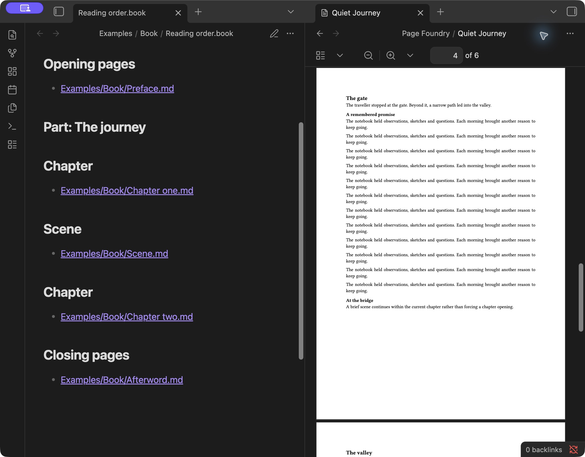
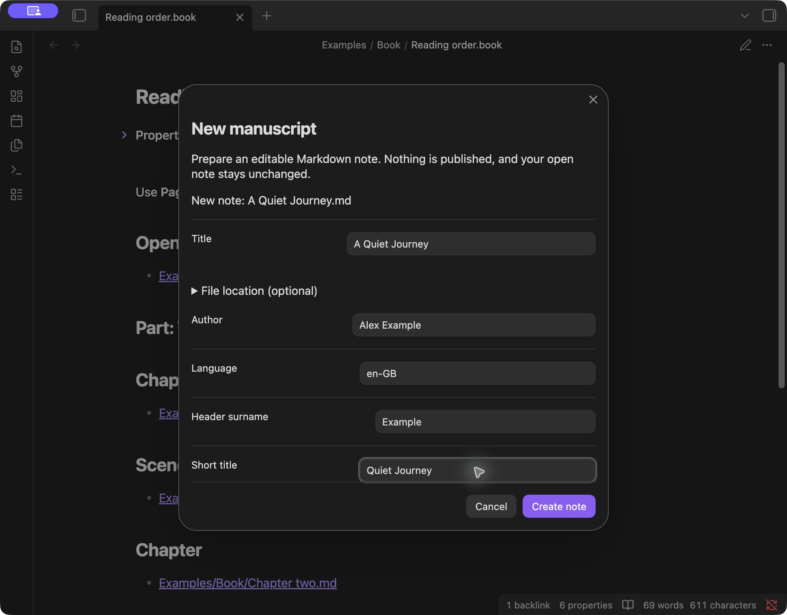

# Page Foundry

Write in Obsidian. Publish letters, manuscripts and books.

Page Foundry turns Markdown into typeset PDFs, reflowable EPUB ebooks and
editable Word documents. Build a book from your chapter notes, prepare a
manuscript for submission, or write a letter with a reusable layout. Your notes
remain the originals; publishing creates separate files.



## Get started

Install Page Foundry with [BRAT](https://github.com/TfTHacker/obsidian42-brat)
to receive beta builds and updates. You can also install a chosen build from
[GitHub Releases](https://github.com/grobmeier/page-foundry/releases) using the
[installation guide](docs/install.md). Page Foundry is licensed under Apache
2.0.

1. In Obsidian 1.8.7 or newer, install BRAT and run **Add a beta plugin for
   testing**.
2. Add **grobmeier/page-foundry** and enable Page Foundry in Community plugins.
3. Run **Page Foundry: Create new note**, choose a starter and begin writing.
   When ready, run **Page Foundry: Publish**.

See [installation and updates](docs/install.md) or go straight to
[the everyday guide](docs/start-here.md). BRAT remains the beta channel for
trying changes before a stable release; release notes identify each build.

## From first draft to finished document

- **Start with the right document.** Letter, Submission letter, Manuscript, Book
  and Plain document are available directly. Enter a title and the filename
  follows; folder and filename overrides live under File location.
- **Keep details readable.** Save addresses, author details and publication
  information through a form. Change an individual note's document type without
  replacing its writing.
- **Publish with a remembered layout.** Choose PDF, EPUB or DOCX, review the
  design and save. Page Foundry remembers successful layouts per note. Changing
  layouts keeps compatible temporary choices; cancelling returns to your review.
- **Reuse your work.** Create recent brings back used starters. Save as note
  template turns a note into a reusable Markdown starting point. The built-in
  Cheat Sheet explains the everyday commands.



Letters keep the greeting, sign-off and signature in the writing, with separate
sender and recipient addresses. Manuscript presets provide a title page,
double-spaced body, running header and numbered body pages in A4 or US Letter.
Use your publisher's requirements to choose the final settings.

## Build a book from your notes

Create a Book, then open **Edit document details** to add chapter notes and
arrange them. Include opening pages, parts, chapters, continuous scenes and
closing pages. The reading-order plan is ordinary Markdown with headings and
note links; the form manages the structure for you.

Publish the plan to build the whole book, or publish a chapter on its own.
Reorder or revise your notes and publish again. Only included notes and their
referenced images enter the book; chapter files stay unchanged.

**Paperback proofs** support 5 × 8, 5.5 × 8.5 and 6 × 9 inch interiors, white or
cream paper, mirrored gutters and right-hand or next-page chapter starts. Page
Foundry measures the generated pages to calculate gutters and produces a proof
report. These are no-bleed, black-ink interiors for proofing; covers, spines and
final retailer approval are separate production steps.

## Make the design your own

**Manage designs** provides form-based book and document design editors. Book
designs control title, imprint and contents pages, chapter openings, typography
and running headers. Create a proof of an unsaved book design, adjust it, then
save and reuse it.

Note templates supply starting text and properties; output designs control
appearance. Keep your custom Markdown templates and versioned JSON design packs
in your own vault or private storage and register their exact paths in settings.
Private designs stay separate from the public plugin.

Start with the [private-template walkthrough](docs/custom-templates.md), or read
[note templates](docs/note-templates.md), [book designs](docs/book-designs.md)
and the [preset-pack reference](docs/preset-packs.md). Print-page design
controls apply to PDF; EPUB and DOCX use their own format-specific layouts.

## Publish and find your files

Save to a configurable vault folder, normally **Page Foundry**. Existing files
are preserved with numbered filenames. The result shows the actual saved path,
with **Show in folder** and **Open in default app** on supported desktop hosts.
EPUB and DOCX files can be hidden in Obsidian's sidebar even after a successful
save. On hosts that support file sharing, **Share or save elsewhere** opens the
system share sheet for Files and installed storage providers.

Markdown headings, lists, quotations, links, PNG/JPEG images, pipe tables and
literal code blocks are supported. PDF tables wrap cells, repeat headings across
pages and use stacked rows when a table would become too narrow. Publishing
checks required details, resources and EPUB heading links, then rechecks changed
inputs before creating the file. See
[supported content and limits](docs/supported-content.md).

## Built with

The plugin is written in **TypeScript** using the **Obsidian API** for commands,
forms, settings and vault access. A shared document model connects the authoring
workflow to three format-specific renderers:

| Output | Technology                                                           | What it produces                                                                    |
| ------ | -------------------------------------------------------------------- | ----------------------------------------------------------------------------------- |
| PDF    | **Typst**, compiled to WebAssembly and embedded through **Typst.ts** | Typeset pages, manuscript layouts and measured paperback proofs                     |
| EPUB 3 | Semantic **XHTML/CSS**, packaged with **fflate**                     | Reflowable text, publication metadata, contents navigation and local images         |
| DOCX   | The **docx** TypeScript library                                      | Editable Open XML documents with headings, tables, images and manuscript formatting |

**unified/remark** parses Markdown, including pipe tables and Obsidian image
embeds; **yaml** reads saved note properties and book metadata. The PDF compiler
loads on first use, with **Libertinus Serif** and **DejaVu Sans Mono** bundled
for offline typesetting.

Rendering runs inside Obsidian on your device. The plugin reads the selected
note or book, its referenced resources and explicitly registered templates and
packs. It does not upload manuscripts or collect telemetry. Vault sync, sharing
and backups remain under your own storage settings.

For the implementation details, see the
[rendering architecture](docs/architecture/mobile-rendering.md).

## Development and testing

Use Node.js 22.12 or newer and npm. **esbuild** bundles the plugin,
**TypeScript** checks types, and the **Node.js test runner** exercises the
authoring and export workflows.

```sh
npm ci
npm run verify
npm run test-vault
```

The example installer adds neutral notes to the ignored test vault without
replacing existing writing, private designs, BRAT or settings. Install the
plugin through BRAT, save pending edits and fully reload Obsidian, then open
**Start here**. See the [author test path](docs/testing/authoring-templates.md)
and [test-vault maintenance guide](docs/testing/test-vault.md).

Desktop workflows have automated and native Obsidian checks. Physical
iPad/iPhone/Android rendering, memory and sharing, and assistive-technology
acceptance are ongoing. EPUB readers and retailer/physical proofs have separate
[acceptance checks](docs/testing/local-images-and-mobile.md).

## Contributing and licence

Contributions are welcome. See [CONTRIBUTING.md](CONTRIBUTING.md),
[SECURITY.md](SECURITY.md) and [CODE_OF_CONDUCT.md](CODE_OF_CONDUCT.md).

Copyright 2026 Christian Grobmeier. Licensed under the
[Apache License, Version 2.0](LICENSE).
